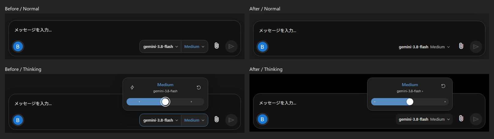
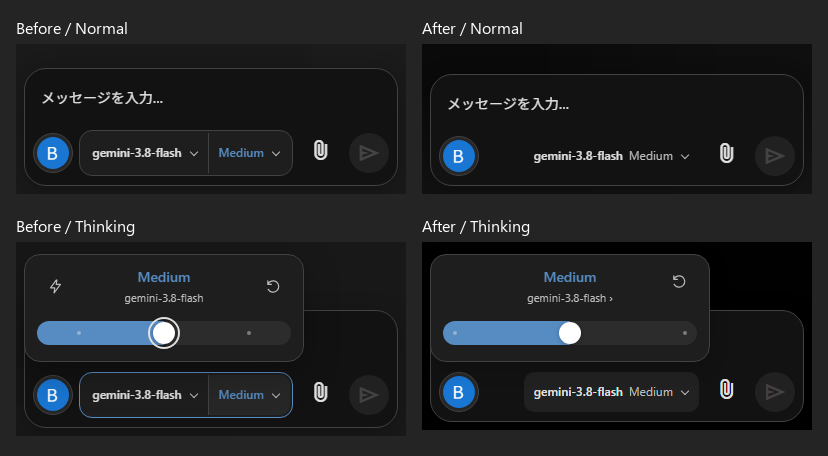
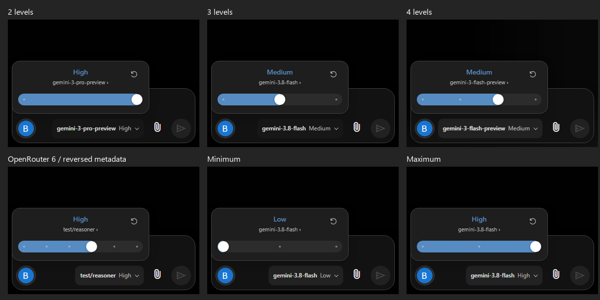

# ChatAI PWA v1.36.0 リリース変更・検証索引

## 変更範囲

グローバル／プロファイル／チャット／端末の設定スコープを分離し、API資格情報と接続先を共通管理する。設定画面は一般・プロファイル・外部連携・その他の4カテゴリへ整理した。モデルとThinkingの操作を統合し、サイドバーと付随パネル、チャット・履歴・設定の背景を統一した。

IndexedDB移行・フィールド更新・背景Blobと参照の原子性、Provider継続情報、送信準備の所有権を保護する。J修正では旧API移行を原子的処理へ統合し、無効署名の復活を防止した。実Provider送信内容を署名依存の基準とし、大容量履歴の検証・変換をWorkerへ移した。SWは14資源を検証してから新しいシェルへ切り替える。

## 設計と修正記録

- [設定構造・移行設計](v1.36.0-phase1.md)
- [Phase 2実装記録](v1.36.0-phase2.md)（掲載画像は当時の実装段階。最終UIの比較は下記）
- [Thinkingモデル対応](v1.36.0-thinking-fix.md)
- [Thinkingパネルの保存・操作継続](thinking-popover-persistence.md)
- [R01〜R08](review8-fixes-v136.md)
- [N01〜N06](review-n-fixes-v136.md)
- [I01〜I05](integration-i-v136/report.md)
- [J01〜J04最終報告](integration-j-v136/report.md)
- [最終検証要約](integration-j-v136/verification-summary.json)
- [性能比較](integration-j-v136/performance-comparison.md)

各報告はその時点の検証記録であり、最終状態はJ報告を優先する。報告中の詳細ログ、before資源、全量画像・中間JSON・OCR・ZIP等への記述はローカル保管の証跡も含む。それらは今回の公開対象から除外し、削除していない。

## 代表UI画像

隔離fixtureのダミー設定を使用した比較画像。







## 検証と再実行

製品ロジックはJ最終検証時と同じ。コミット準備では新規settings-v136.jsの26行の末尾空白だけを整え、SW指紋を再生成した（トークン変更なし）。公開資源のbuild IDは `de3970c70dd93c2ca82e`、14資源一致。既存203件にJ追加35件を加えた238件（Node 69、Browser 169）、サイドバー・背景80項目、SW通常更新・不正更新拒否・旧版保持・オフライン起動が成功した。全量ログを公開せず、上記の検証要約を含める。

コミット準備では製品コードの再設計を行わず、テストの比較基準だけを変更前コミット `198c8d5b3ff130034edd1250a965febe3d2aa6b9` へ固定した。これによりコミット後も旧HTMLのID比較と旧SWからの更新を検証する。テストにはこの基点へアクセスできるGit履歴が必要（CIのcheckoutでは履歴を含める）。

Nodeの各テストファイルを直接実行し、ブラウザ・指紋は次のコマンドで確認できる。

```text
python -B tests/run-browser-tests.py --j --ui --sw
python -B tests/update-shell-integrity.py --check
```

`tests/run-integration-i-v136.py` / `tests/run-integration-j-v136.py` のafter検証は現行ソースを使う。before検証や比較画像生成は、公開対象に含めないローカルの修正前資源・検証成果物を別途必要とする。

## 既知の制約

- 実Gemini／OpenRouter／Z.ai／Bedrock API、実Dropbox転送、実SDサーバーは未検証。
- 実機へインストールしたPWA、Chrome以外のブラウザは未検証。
- 過去の手動SW再構築の単発失敗は原因未特定・診断不足Warningとして維持する。
- 一部fixture読込み・CDPタイムアウトの根本原因は未特定。最終統合実行は成功した。
- 20MiB生成全体（検証用JSON検査を含む）では最大89msのLong Taskを観測。保存・履歴準備専用比較とは区別する。
- 既に破損して元依存情報を失った旧会話を復元するものではない。

マージ前にGitHubのCI実行状態を確認する。PR作成はマージ・タグ作成・Release公開を意味しない。
