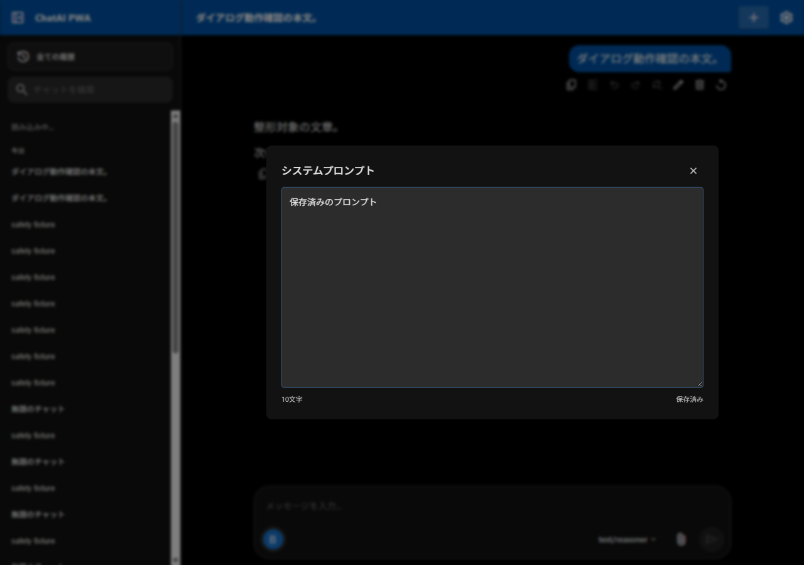
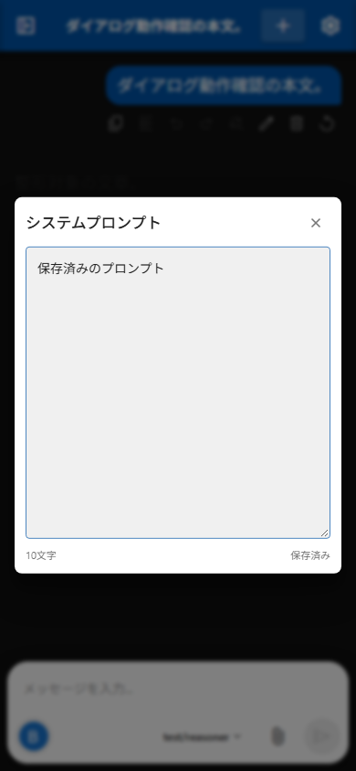
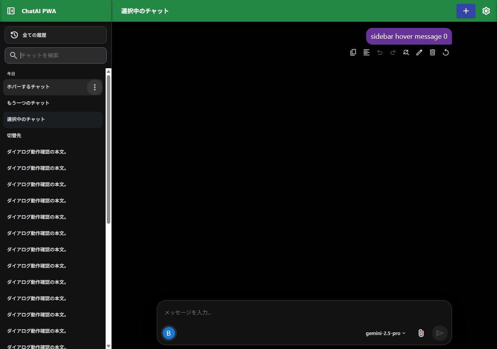
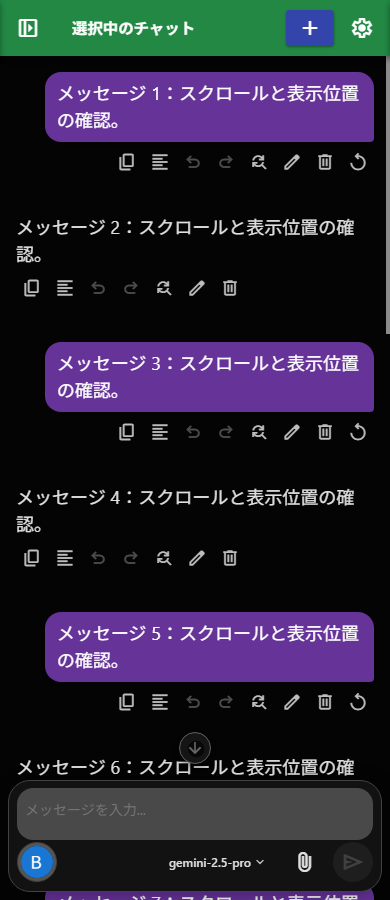

# ChatAI PWA v1.36.1 リリース記録

v1.36.1の公開対象、コミット前の最終検証、既知問題を記録する。ビルドIDは `6ad1738e304358051d49`。マージと公開結果はPR・Pagesの実行記録で確認する。

公開中v1.36.0の既存ハッシュ不一致を記録し、新版への移行可否を基準に評価した。旧インストール失敗、有効な旧1.36.0キャッシュ保持、旧1.35.1 Worker保持の3経路から、ステージ済みv1.36.1へ安全に移行する検証が成功した。

v1.36.0の比較基点は `db1462a61eb954addd2467d626816566300a193b`。mainへ通常マージされた `bb7d381d159a5c4a28d3896d64fc7ef7bef51ff2` とファイル内容が同一であることを確認し、そこから `feature/v1.36.1` を作成した。

## 変更内容

- フローティングボタン、最下部スクロールボタン、サイドバーのホバー表示・操作メニュー・チャット領域との配置を改善。
- システムプロンプト編集をチャット用ダイアログのデザインに統一。コンテキスト圧縮確認を含むダイアログをサイドバーと可視領域へ対応。
- ダイアログ外側のクリック・タップで最前面だけを閉鎖。ドラッグ、タッチスクロール、内部操作を除外し、背後へのクリック伝播を抑止。
- Android PWAのナビゲーションバー色への対応としてmanifestのテーマ色を `#1e1e1e` に変更。HTML側の動的テーマカラーはチャット背景へ追従する既存処理を維持。このmanifest値はユーザーが実機で確認した仕様。
- R1: 同梱DOMPurifyによるMarkdown描画のサニタイズ。ライセンスを同梱。
- R2: システムプロンプトの700ms自動保存、編集リビジョン、保存スナップショット、保存直列化、最新編集の保存完了待機、失敗時の内容保持、チャット所有者検証。
- R3: 添付変換の操作所有者を確認し、キャンセルやチャット切替後の古い結果混入を防止。
- R4: 送信・編集中、未保存データ、添付処理、DB処理などの間はService Worker更新を延期。更新失敗時の旧シェル維持を継続。
- R5: 最後のシステムプロンプトを空にした場合も保存し、保存中の初回挿入との競合を保護。
- F1: 開閉要求を操作トークンで識別し、await後の操作・対象チャット・画面を検証。古いclose通知・古い保存完了が再オープン後の編集を閉じないよう修正。
- F2: 押下対象とscroll発生元の関係を確認し、背景自動スクロール中も外側クリックを正しく判定。

## バージョンと互換性

APP_VERSIONは `1.36.1`、APP_CACHE_VERSIONは `v1.36.1`、CACHE_NAMEは `chatai-pwa-cache-v1.36.1`。HTMLとSWの版付き資源URLを統一し、全アプリシェル変更後に15資源のSHA-256を再生成する。DOMPurifyはmarked.jsの後、アプリより前にdeferで読み込む。DB_VERSIONは13のままで、今回のリリースによるスキーマ更新はない。

## 最終検証

正式なGitインデックスへ公開対象40ファイルを明示して選別し、`--check --staged` を実行した。全15資源のSHA-256とSWの生成済み整合性情報が一致し、ビルドIDは `6ad1738e304358051d49`。作業ツリーのアプリシェル資源も同じバイト列だった。

最終候補でNode既存8ファイル、新規Python回帰5件、ブラウザ基本・統合169ケース、安全性18ケース、F1/F2 18ケース69アサーション＋ネイティブF2 6が成功した。ダイアログ690、サイドバー720、スクロールボタン467、テーマカラー73、レスポンシブ263、resize 8、縮小Viewport 4、ネイティブ入力60、追加サイドバー・背景80アサーションも成功した。

通常のSW更新、不正HTML/JS/CSS/参照/通信失敗の拒否、旧Worker・旧シェル維持、キャッシュ再構築、複数タブ読み込み、HTTPキャッシュ消去・サーバー/Worker停止後のオフライン起動、オフラインDOMPurifyのサニタイズを確認した。新規プロファイルで最終実行した。

公開対象のJS17/Python8ファイル構文、v1.36.1の参照・読み込み順、git diff --check、git diff --cached --check、依存ファイルと文書リンク、秘密情報形式を監査した。秘密情報形式の検出0件、参照先不足0件。READMEなど非シェルファイルのGitによるCRLF→LF変換は、テキストが同一であることを確認した。

[機械可読検証記録](v1.36.1-verification.json) と [停止要因の修正・比較検証](sw-release-blockers-v1361.md) を含める。詳細ログ・Network記録・既存検証出力の退避物はローカルに保持し、既存資料39ファイルは元の内容へ戻した。

```text
python -B tests/shell-integrity-publication.test.py
python -B tests/browser-server-burst.test.py
python -B tests/run-browser-tests.py --j --ui --sw --dialog-races --safety --dialogs --sidebar-hover --scroll-buttons --theme-color
python -B tests/update-shell-integrity.py --check --staged
```

旧HTML・旧Workerとの比較には `198c8d5b3ff130034edd1250a965febe3d2aa6b9` を含むGit履歴が必要。任意のbefore比較に使うローカルの修正前コピーは公開対象から除外する。公開中v1.36.0のインストール拒否を起点に、新版への移行を隔離環境で検証した。有効な旧キャッシュの再現では旧ハッシュに一致する改行表現を復元し、古いWorkerへの変更を加えずに試験した。全3経路で旧更新失敗時の保持、新候補の有効化、複数タブ、キャッシュ再構築、オフライン起動とオンライン復帰、保存データの保持を確認した。マージ後は公開15資源の実バイト列と、新規・旧失敗プロファイルでの導入を再確認する。

## 代表画面

隔離fixtureとダミー設定による最終検証画面。実ユーザーのチャットや資格情報は含めない。






## 既知問題と残存リスク

送信開始直後、isSending=trueからAbortController生成までの初回保存・履歴準備中にチャット切替や停止を行うと、中断要求が保持されず、旧チャットのAPI要求が開始・継続する場合がある。v1.36.0比較基点でも遅延を制御した最小検証で再現し、主要な送信・中断・リトライ処理は同一だった。重要度はMedium、v1.36.2へ延期可能と判断した既知問題として残す。

この競合では切替が最大10秒待機後に失敗として戻る場合がある。今回の最小検証では応答の切替先混入・誤保存・回復不能な固着は確認せず、通信完了、タイムアウト、または再度の停止で回復した。タイムアウト無効時は自動的な待機上限がなく、不要なAPI利用・課金の可能性がある。実課金と実プロバイダー通信は未検証。

実API、実Dropbox・SD通信、Safari/Firefox、実OSソフトキーボードは今回の自動検証に含めない。Android manifestテーマ色の実機確認はユーザーからの確認情報であり、今回のエージェントによる実機試験ではない。

## 公開対象の選別

製品コード、manifest・SW、DOMPurify本体とライセンス、回帰テストと実行補助、この記録・検証要約、代表画像4枚を明示パスで選別する。大量の中間画像、重複画像、詳細ログ、before資源、OCR、ZIP、個人情報・認証情報・ローカル固有の監査資料を含めない。除外物はローカルに保持する。既存の検証出力も実行前に保存し、最終画面の採取後に元の内容へ戻す。

PRのbase/head、公開差分、マージ競合、要求されるチェックを確認してから通常のマージコミット方式でmainへ取り込む。Gitタグ・GitHub Release公開・ブランチ削除は今回の作業に含めない。GitHub Pagesの最終デプロイ状態と公開資源はマージ後に別途確認する。
